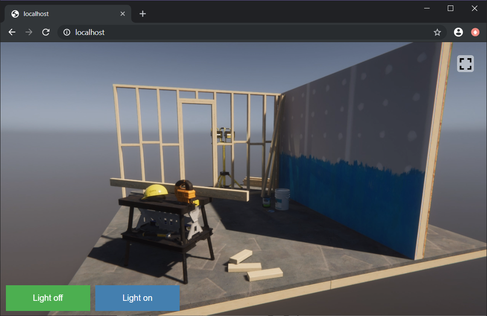

# Unity Render Streaming Hub


**Unity Render Streaming** is a solution that provides Unity's high quality rendering abilities via browser. It's designed to meet the needs of tasks like viewing car configurators or architectural models on mobile devices.
This solution's streaming technology takes advantage of [WebRTC](https://webrtc.org/), and developers can even use the [WebRTC package](https://docs.unity3d.com/Packages/com.unity.webrtc@latest) to create their own unique solutions.



## Unity Render Streaming Hub

This repository starts from a source snapshot of the maintained Unity Render Streaming 3.1 branch, preserving the package identity, licenses and existing connection APIs. Its independent Git history starts on `main`; upstream commit history is not imported.

See [Maintenance and shared package setup](MAINTENANCE.md) for setup and validation. The optional [instance pool](INSTANCE_POOL.md) adds exclusive sender allocation and receiver queues through a separate endpoint. Existing Public/Private connections and `/receiver/index.html` keep their existing behavior; the pool is disabled by default. Device and business integrations remain in consuming projects.

## Requirements

Please see [Requirements](com.unity.renderstreaming/Documentation~/index.md#requirements) section.

### License

- `com.unity.renderstreaming` -  [LICENSE.md](com.unity.renderstreaming/LICENSE.md)

- `com.unity.template.renderstreaming-hd` -  [LICENSE.md](com.unity.template.renderstreaming-hd/Packages/com.unity.template.renderstreaming-hd/LICENSE.md)

- `com.unity.template.renderstreaming-rtx` -  [LICENSE.md](com.unity.template.renderstreaming-rtx/Packages/com.unity.template.renderstreaming-rtx/LICENSE.md)

## Repository Structure

```
<root>
├── BuildScripts~                          // Build scripts for CI system
├── com.unity.renderstreaming              // Unity Render Streaming Package
├── com.unity.template.renderstreaming-hd  // HDRP template
├── com.unity.template.renderstreaming-rtx // HDRP Raytracing template
├── RenderStreaming~                       // Sample project for package
└── WebApp                                 // Web application for signaling
```

## FAQ

Please read [this page](com.unity.renderstreaming/Documentation~/faq.md) and [Unity Forum](https://forum.unity.com/forums/unity-render-streaming.413/).
